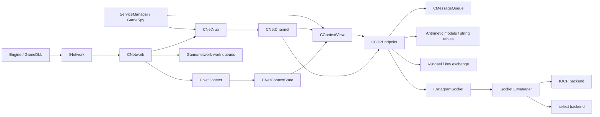
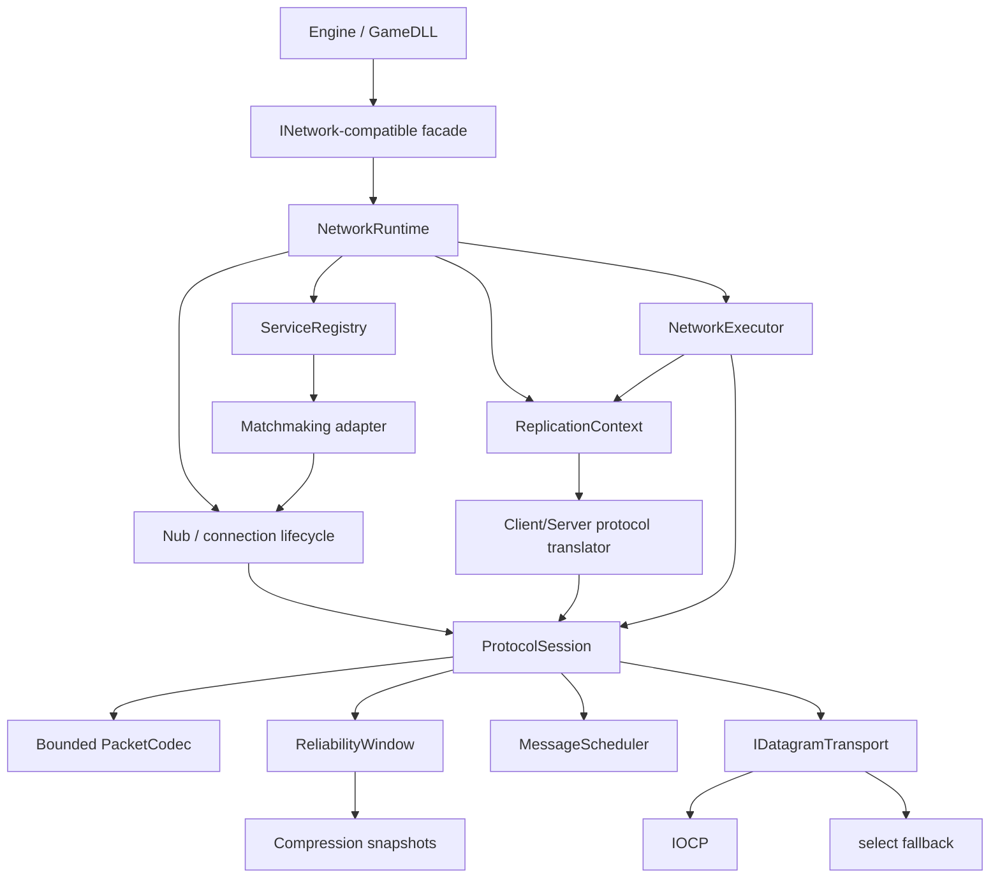

# CryNetwork Architecture Review

This review covers the live CryNetwork tree under `G:/projects/CRYENGINE-VC14/CrysisWars`, including current tracked edits and untracked CryNetwork test sources. It is a source-level architecture review, not a review of the historical VC8 snapshot. Findings marked **Confirmed** follow an implementation path in the current source. Findings marked **Inferred risk** are plausible consequences of a visible contract or design, but were not reproduced dynamically.

## 1. Executive Summary

CryNetwork is a sophisticated, purpose-built real-time networking stack. It combines platform socket backends, connection setup, reliable message delivery over UDP, adaptive arithmetic compression, synchronized replication, service integration, and engine-thread handoff. Its strongest engineering is in the transport machinery: `CCTPEndpoint`, `CMessageQueue`, the socket I/O abstraction, and the replication histories encode substantial knowledge about bandwidth-limited game networking.

Its main weakness is that the boundaries between those mechanisms are not represented cleanly in the architecture. `CNetwork` is simultaneously the process-wide service locator, scheduler, thread coordinator, queue owner, lock owner, factory, configuration hub, and diagnostics entry point. `CContextView` and `CCTPEndpoint` each combine several state machines and responsibilities. Correctness depends on a global recursive lock, phase-specific work queues, debug-only assertions, intrusive lifetimes, and a hidden current memento allocator. Those contracts are understandable only by following code across several large classes.

The largest long-term risk is not one isolated defect. It is the interaction of implicit thread ownership, implicit state transitions, and protocol state spread across `CNetwork`, `CNetNub`, `CNetChannel`, `CCTPEndpoint`, `CContextView`, and `CNetContextState`. A local change can preserve compilation while violating ordering, lifetime, wire-format, or allocator assumptions elsewhere.

Maintainability is moderate-to-low for new developers and moderate for developers already familiar with the engine. Incremental modernization is practical; a rewrite is neither necessary nor advisable. The best route is to preserve the existing wire protocol and scheduling behavior while making thread, ownership, buffer, failure, and service boundaries explicit.

**Overall architecture score: 5/10.** The score credits a capable transport, useful abstractions, and intentional game/network synchronization. It is held back by concentrated complexity, hidden global contracts, obsolete trust mechanisms, weak test isolation, and direct third-party coupling in core paths.

---

## 2. System Overview

CryNetwork supplies the CryEngine runtime's multiplayer networking. The engine creates one `CNetwork` through [`CreateNetwork()`](/G:/projects/CRYENGINE-VC14/CrysisWars/CryEngine/CryNetwork/CryNetwork.cpp:55), using the broad public [`INetwork`](/G:/projects/CRYENGINE-VC14/CrysisWars/CryEngine/CryCommon/INetwork.h:407) interface. `CNetwork` initializes Winsock, name resolution, socket I/O, scheduler configuration, services, the network thread, queues, and shared synchronization.

The principal runtime path is:

1. `CNetwork` creates a `CNetNub` and a `CNetContext`.
2. `CNetNub` owns a bound datagram socket and maps remote addresses to `CNetChannel` instances.
3. A `CNetChannel` owns a `CCTPEndpoint` and a client- or server-side `CContextView`.
4. `CContextView` converts replication and RMI events into `INetSendable` messages.
5. `CCTPEndpoint` and `CMessageQueue` schedule, compress, frame, sequence, acknowledge, retransmit, sign, optionally encrypt, and send those messages.
6. `IDatagramSocket` submits operations through `ISocketIOManager`; the active backend is IOCP or `select`, with a null backend as a final fallback.
7. Incoming datagrams travel back through the nub, channel, endpoint, message mapper, context view, replication histories, and game-thread work queues.



Important abstractions include [`INetwork`](/G:/projects/CRYENGINE-VC14/CrysisWars/CryEngine/CryCommon/INetwork.h:407), [`ISocketIOManager`](/G:/projects/CRYENGINE-VC14/CrysisWars/CryEngine/CryNetwork/Socket/ISocketIOManager.h:123), `IDatagramSocket`, [`INetSendable`](/G:/projects/CRYENGINE-VC14/CrysisWars/CryEngine/CryCommon/INetwork.h:165), `INetMessageSink`, `CMessageMapper`, and the client/server `CContextView` subclasses. There is no general durable persistence layer in core CryNetwork. Its storage mechanisms are transient protocol state, replication histories, memento allocations, and service-specific storage APIs.

---

## 3. Repository / Module Architecture

| Module | Primary responsibility | Boundary quality |
| --- | --- | --- |
| Root (`Network`, timer, CVars, logging) | Runtime coordination, lifecycle, threading, queues, global state, profiling | Heavily mixed |
| `Socket` | Datagram sockets, DNS/address handling, IOCP/select/null backends | Mostly clear |
| `Protocol` | Nubs, channels, reliable transport, scheduling, framing, encryption | Internally coupled; several oversized classes |
| `Context` | Object identity, authority, aspects, RMIs, replication histories, game synchronization | Responsibilities overlap heavily |
| `Compression` | Arithmetic models, policies, predictors, string/chunk tables | Cohesive, but coupled to context state and wire format |
| `Streams` | Arithmetic and byte-oriented serialization streams | Useful primitives with unsafe low-level contracts |
| `Services` | Service extension framework and GameSpy/CryLAN implementations | Framework exists, but GameSpy leaks into core paths |
| `Cryptography` | Rijndael, Whirlpool, and modular key exchange | Isolated physically; protocol semantics are legacy |
| `Http` | Embedded HTTP listener and request dispatch | Weakly isolated from trust-sensitive runtime behavior |
| `RemoteControl` | Remote command/control protocol | Separate implementation, global runtime dependencies |
| `AntiCheat` | PunkBuster/defence integration | Conditionally compiled; legacy interface remains public |
| `VOIP` | Voice encoding/decoding | Conditionally compiled out for the current x64 runtime |
| `DebugKit` | Network debugging, packet inspection, simulation | Useful but compile-time and global-state heavy |

The directory structure suggests cleaner layering than the implementation provides. For example, [`CNetNub::OnPacket()`](/G:/projects/CRYENGINE-VC14/CrysisWars/CryEngine/CryNetwork/Protocol/NetNub.cpp:864) directly recognizes GameSpy traffic before normal transport processing. Compression models receive a `CNetContextState` pointer through [`CArithModel::SetNetContextState()`](/G:/projects/CRYENGINE-VC14/CrysisWars/CryEngine/CryNetwork/Compression/ArithModel.h:110). The root `CNetwork` owns and coordinates nearly every subsystem through the member set in [`Network.h`](/G:/projects/CRYENGINE-VC14/CrysisWars/CryEngine/CryNetwork/Network.h:245).

The client/server boundary is expressed mainly by `CClientContextView` and `CServerContextView`, not by separate transport stacks. This is appropriate for shared wire behavior, but it means `CContextView` is both the shared replication coordinator and the base of role-specific behavior.

---

## 4. Architectural Strengths

### Strength: Replaceable socket I/O backend

**Evidence:** [`ISocketIOManager`](/G:/projects/CRYENGINE-VC14/CrysisWars/CryEngine/CryNetwork/Socket/ISocketIOManager.h:123) defines the request/callback boundary. [`CreateSocketIOManager()`](/G:/projects/CRYENGINE-VC14/CrysisWars/CryEngine/CryNetwork/Socket/ISocketIOManager.cpp:7) selects IOCP, then `select`, then a null implementation.

**Why it is good:** Platform I/O behavior is separated from nubs, channels, and protocol logic. Higher layers submit receive/send operations without embedding completion-port details.

**Impact:** This limits platform-specific code and gives the modern x64 runtime a viable IOCP path while preserving a simpler fallback.

### Strength: Explicit game-thread/network-thread handoff

**Evidence:** [`WorkQueue.h`](/G:/projects/CRYENGINE-VC14/CrysisWars/CryEngine/CryNetwork/WorkQueue.h:20) type-erases queued calls while retaining intrusive references. The queue families and handoff macros are declared in [`Network.h`](/G:/projects/CRYENGINE-VC14/CrysisWars/CryEngine/CryNetwork/Network.h:245) and [`Network.h`](/G:/projects/CRYENGINE-VC14/CrysisWars/CryEngine/CryNetwork/Network.h:387). [`CNetwork::SyncWithGame()`](/G:/projects/CRYENGINE-VC14/CrysisWars/CryEngine/CryNetwork/Network.cpp:870) drains phase-specific work.

**Why it is good:** CryNetwork recognizes that game state and network state cannot be mutated arbitrarily from either thread. Queued jobs capture object lifetime and discard work for objects already marked dead.

**Impact:** This is a sound basis for avoiding direct cross-thread calls and for batching synchronization at known engine phases.

### Strength: Purpose-built reliable UDP protocol

**Evidence:** [`CCTPEndpoint`](/G:/projects/CRYENGINE-VC14/CrysisWars/CryEngine/CryNetwork/Protocol/CTPEndpoint.h:45) maintains sequence states, ACK/NACK history, retransmission state, message mapping, compression state, and delivery listeners. [`CCTPEndpoint::ProcessPacket()`](/G:/projects/CRYENGINE-VC14/CrysisWars/CryEngine/CryNetwork/Protocol/CTPEndpoint.cpp:891) validates framing and advances protocol state; [`SendPacket()`](/G:/projects/CRYENGINE-VC14/CrysisWars/CryEngine/CryNetwork/Protocol/CTPEndpoint.cpp:1544) builds the inverse path. [`MessageQueue.cpp`](/G:/projects/CRYENGINE-VC14/CrysisWars/CryEngine/CryNetwork/Protocol/MessageQueue.cpp:1192) schedules sendables according to dependencies and configured priorities.

**Why it is good:** Reliability, ordering, message dependency, and bandwidth allocation are designed around game traffic rather than delegated blindly to a generic byte stream.

**Impact:** The stack can prioritize state updates, preserve message dependencies, and recover from packet loss without TCP head-of-line behavior.

### Strength: Stateful compression is integrated with packet history

**Evidence:** The endpoint keeps 128 sequence states and separates frequently cloned state in [`CTPEndpoint.h`](/G:/projects/CRYENGINE-VC14/CrysisWars/CryEngine/CryNetwork/Protocol/CTPEndpoint.h:136). State cloning recalculates arithmetic probabilities in [`CCTPEndpoint::CState::Clone()`](/G:/projects/CRYENGINE-VC14/CrysisWars/CryEngine/CryNetwork/Protocol/CTPEndpoint.cpp:203). String and integer models live under `Compression`.

**Why it is good:** Compression state follows the same acknowledged basis as reliable packet state. That lets packets remain decodable across loss and retransmission.

**Impact:** This is bandwidth-efficient and demonstrates that transport, compression, and loss recovery were designed together intentionally.

### Strength: Stale and foreign memento handles are now rejected

**Evidence:** [`CMementoMemoryManager::Hdl`](/G:/projects/CRYENGINE-VC14/CrysisWars/CryEngine/CryNetwork/MementoMemoryManager.h:26) is 64-bit. The handle encoding includes index, generation, and a manager-specific cookie in [`MementoMemoryManager.h`](/G:/projects/CRYENGINE-VC14/CrysisWars/CryEngine/CryNetwork/MementoMemoryManager.h:70). Allocation metadata uses `size_t` in [`SHandleData`](/G:/projects/CRYENGINE-VC14/CrysisWars/CryEngine/CryNetwork/MementoMemoryManager.h:154).

**Why it is good:** The live tree no longer treats a truncated integer as sufficient authority to access an allocation slot. Generation and manager identity make stale and cross-manager use detectable.

**Impact:** This materially improves x64 correctness and prevents one class of silent wrong-allocation access in replication history and queued packet storage.

### Strength: Several wire-width boundaries are explicit

**Evidence:** [`CByteStreamPacker::TryGetNextOfs()`](/G:/projects/CRYENGINE-VC14/CrysisWars/CryEngine/CryNetwork/Streams/ByteStream.cpp:6) computes in `size_t`, checks against the 32-bit stream limit, and only then narrows the offset. [`CArithModel::TryWriteString()`](/G:/projects/CRYENGINE-VC14/CrysisWars/CryEngine/CryNetwork/Compression/ArithModel.cpp:70) rejects lengths that do not fit the 12-bit string field.

**Why it is good:** Native allocation width and protocol width are not assumed to be the same. The checked boundary preserves the existing protocol instead of widening packets accidentally during the x64 port.

**Impact:** This supports interoperability with legacy peers while allowing internal code to use `size_t` safely.

---

## 5. Weaknesses

### Weakness: Ambiguous operation results

**Severity:** High

**Evidence:** [`CNetNub::SendTo()`](/G:/projects/CRYENGINE-VC14/CrysisWars/CryEngine/CryNetwork/Protocol/NetNub.cpp:830) returns `true` for a recoverable socket error, so the caller cannot distinguish sent, queued, deferred, or retriable outcomes. Several factories and initialization paths communicate failure with null pointers or booleans.

**Current design:** Different subsystems use `bool`, null, logging, disconnect causes, assertions, and side effects to represent failure.

**Problem:** A boolean is too small for operations whose valid outcomes include accepted, completed, would-block, dropped, disconnected, and fatal error.

**Consequences:** Callers can update accounting or state as if work completed when it was only accepted or deferred. Failure recovery is distributed across implementation knowledge.

**Recommendation:** Introduce small subsystem-level result enums, beginning at socket send, queued message submission, stream write, and connection setup boundaries. Convert to public legacy booleans only at the outer ABI.

### Weakness: Incomplete runtime statistics

**Severity:** Medium

**Evidence:** [`CNetNub::GetStatistics()`](/G:/projects/CRYENGINE-VC14/CrysisWars/CryEngine/CryNetwork/Protocol/NetNub.cpp:729) contains a TODO and returns a member without assembling current state.

**Current design:** Detailed counters exist throughout endpoint and socket code, but the public aggregation path is incomplete.

**Problem:** The stack is complex enough that correctness and performance depend on observing queue depth, retries, drops, lock stalls, and protocol state.

**Consequences:** Live failures are harder to distinguish from bandwidth pressure, packet loss, queue growth, or thread starvation.

**Recommendation:** Define one immutable per-tick statistics snapshot assembled from existing counters. Include socket queue depth, endpoint send queue depth, dropped/retried packets, work-queue age, and global-lock wait time.

### Weakness: Build policy does not guarantee C++20 for CryNetwork

**Severity:** Medium

**Evidence:** [`CryNetwork.vcxproj`](/G:/projects/CRYENGINE-VC14/CrysisWars/CryEngine/CryNetwork/CryNetwork.vcxproj:61) uses v143 but contains no `LanguageStandard` property. The test project explicitly selects C++20 in [`CryNetworkTests.vcxproj`](/G:/projects/CRYENGINE-VC14/CrysisWars/CryEngine/Tests/CryNetworkTests/CryNetworkTests.vcxproj:60).

**Current design:** Toolset modernization and language-mode modernization are configured independently, and only the tests state the latter.

**Problem:** Developers can compile production and tests under different language rules.

**Consequences:** A compatibility fix can pass tests but fail or behave differently in the actual DLL project.

**Recommendation:** Put the runtime language standard and warning policy in one imported property sheet used by both production and test projects, with deliberate exceptions documented per target.

### Weakness: Legacy feature matrix remains in the primary runtime project

**Severity:** Medium

**Evidence:** [`CryNetwork.vcxproj`](/G:/projects/CRYENGINE-VC14/CrysisWars/CryEngine/CryNetwork/CryNetwork.vcxproj:3) still carries Win32, PS3 makefile, demo/beta, PunkBuster, and voice-era configuration. Runtime feature defaults also remain compile-time switches in [`Config.h`](/G:/projects/CRYENGINE-VC14/CrysisWars/CryEngine/CryNetwork/Config.h:117).

**Current design:** One project and shared headers encode historical platforms and products alongside the modern Win64 target.

**Problem:** Inactive branches remain part of parsing, IntelliSense, project maintenance, and conditional reasoning.

**Consequences:** Configuration drift and accidental feature reactivation become more likely; developers must reason about combinations that are no longer supported.

**Recommendation:** Preserve source history, but define a modern runtime property sheet and a single authoritative `CRYNETWORK_MODERN_RUNTIME` feature profile. Remove unsupported configurations from the new solution rather than deleting code prematurely.

### Weakness: Fixed-size and unbounded buffering coexist

**Severity:** High

**Evidence:** IOCP requests embed a fixed 4096-byte buffer in [`SIORequest`](/G:/projects/CRYENGINE-VC14/CrysisWars/CryEngine/CryNetwork/Socket/SocketIOManagerIOCP.h:148). The select backend stores per-send 4096-byte list nodes in [`SocketIOManagerSelect.h`](/G:/projects/CRYENGINE-VC14/CrysisWars/CryEngine/CryNetwork/Socket/SocketIOManagerSelect.h:53) and appends them in [`RequestSend()`](/G:/projects/CRYENGINE-VC14/CrysisWars/CryEngine/CryNetwork/Socket/SocketIOManagerSelect.cpp:533) without a visible queue limit.

**Current design:** Packet size is bounded, but the number of pending packet buffers is not consistently bounded.

**Problem:** Backpressure is a queue-count problem as well as a packet-size problem.

**Consequences:** A blocked or slow socket can grow process memory in the select backend, while callers receive no structured pressure signal.

**Recommendation:** Add per-socket byte and datagram limits, expose queue-full as an explicit send result, and define which message classes may replace older queued data.

---

## 6. Architectural Faults

### Architectural Fault: Process-wide coordinator is a service locator and synchronization domain

**Severity:** High

**Affected components:** `CNetwork`, sockets, services, contexts, nubs, CVars, timer, logging, work queues.

**Evidence:** [`CNetwork`](/G:/projects/CRYENGINE-VC14/CrysisWars/CryEngine/CryNetwork/Network.h:123) owns the member registry, timer, queue families, compression manager, scheduler configuration, service manager, network thread, global locks, socket manager, commands, and connectivity detection. It exposes a singleton through `CNetwork::Get()`. [`UpdateTick()`](/G:/projects/CRYENGINE-VC14/CrysisWars/CryEngine/CryNetwork/Network.cpp:985) holds the global lock around timer, queue, and member work. Initialization order is documented as a member-layout concern in [`Network.h`](/G:/projects/CRYENGINE-VC14/CrysisWars/CryEngine/CryNetwork/Network.h:248).

**Why this is architectural:** The responsibilities cannot be changed or tested independently because they share object identity, lock ownership, lifecycle, and global access.

**Failure mode:** A callback made while the coordinator lock is held can re-enter another subsystem, block, or observe partial shutdown. A new service can become dependent on construction order without declaring that dependency.

**Growth impact:** More features increase lock contention, initialization-order constraints, and the number of paths that require the singleton.

**Recommended architecture:** Keep one runtime facade for ABI compatibility, but have it own three cohesive modules: runtime lifecycle, network execution/queues, and service registry. Pass narrow references at construction instead of calling `CNetwork::Get()` from lower layers.

**Current dependency direction**

```text
Protocol -----> CNetwork singleton <----- Services
Socket  ------> global lock        <----- Context
Compression --> ambient allocator  <----- Histories
```

**Recommended dependency direction**

```text
INetwork facade -> Runtime
Runtime -> ExecutionContext + ServiceRegistry + TransportFactory
Protocol -> ExecutionContext interface
Context  -> ProtocolSession interface
Services -> ServiceHost interface
```

### Architectural Fault: Thread-safety is a debug convention, not an enforced API contract

**Severity:** High

**Affected components:** Work queues, `CNetwork`, `CNetNub`, `CNetChannel`, `CCTPEndpoint`, memento manager.

**Evidence:** The `FROM_GAME` macro states that it is not thread-safe and relies on external synchronization in [`Network.h`](/G:/projects/CRYENGINE-VC14/CrysisWars/CryEngine/CryNetwork/Network.h:387). `ASSERT_GLOBAL_LOCK` becomes empty in non-debug builds in [`Network.h`](/G:/projects/CRYENGINE-VC14/CrysisWars/CryEngine/CryNetwork/Network.h:356). Queue thread checks are disabled by [`CHECKING_POLYMORPHIC_QUEUE`](/G:/projects/CRYENGINE-VC14/CrysisWars/CryEngine/CryNetwork/Config.h:170). `CMementoMemoryManager` relies on the same external global lock rather than internal synchronization.

**Why this is architectural:** Thread ownership is a property of the call graph, but the type system and release runtime do not represent or verify it.

**Failure mode:** A valid-looking call from the wrong thread can race a queue, handle table, channel state, or shutdown. The debug build may catch some violations that release silently accepts.

**Growth impact:** Every new entry point must rediscover which lock and phase are required. Parallelizing independent channels becomes difficult because one lock defines the whole domain.

**Recommended architecture:** Introduce an `INetworkExecutor` with explicit `PostToNetwork`, `PostToGame`, and `IsNetworkThread` operations. Restrict mutable endpoint/context methods to the network executor. Retain the global lock initially, but make lock ownership assertions active in all developer builds and migrate toward per-runtime plus per-channel ownership.

### Architectural Fault: `CCTPEndpoint` combines the complete transport pipeline

**Severity:** High

**Affected components:** Reliable transport, message scheduling, compression, serialization, packet security, statistics, debug behavior.

**Evidence:** [`CCTPEndpoint`](/G:/projects/CRYENGINE-VC14/CrysisWars/CryEngine/CryNetwork/Protocol/CTPEndpoint.h:45) exposes sendable management, packet processing, ACK handling, state listeners, timeout behavior, and channel callbacks. Its state embeds arithmetic models, message alphabets, Rijndael state, sequence histories, send queues, packet assembly, and statistics. The implementation spans packet receive near [`ProcessPacket()`](/G:/projects/CRYENGINE-VC14/CrysisWars/CryEngine/CryNetwork/Protocol/CTPEndpoint.cpp:891) through packet construction in [`SendPacket()`](/G:/projects/CRYENGINE-VC14/CrysisWars/CryEngine/CryNetwork/Protocol/CTPEndpoint.cpp:1544).

**Why this is architectural:** Framing, reliability, scheduling, compression-state evolution, and cryptographic protection are distinct policies, yet they share one mutable class and one sequence-state representation.

**Failure mode:** Changing packet protection or compression can invalidate retransmission basis state. Changing queue behavior can disturb reliability bookkeeping. Unit tests require constructing too much endpoint state.

**Growth impact:** New message types, protocol versions, or transport protections add branches to the same state machine and increase regression risk.

**Recommended architecture:** Preserve one `ProtocolSession` owner, but extract value-oriented collaborators: `PacketCodec` for bounded framing, `ReliabilityWindow` for sequence/ACK state, and `MessageScheduler` around the existing queue. Keep compression snapshots owned by the reliability window because that coupling is intentional. Avoid splitting every helper into a new class; these three boundaries correspond to independently testable behavior already visible in the code.

### Architectural Fault: Replication coordination is spread across oversized, overlapping state owners

**Severity:** High

**Affected components:** `CNetContext`, `CNetContextState`, `CContextView`, client/server context views, histories.

**Evidence:** [`CNetContext`](/G:/projects/CRYENGINE-VC14/CrysisWars/CryEngine/CryNetwork/Context/NetContext.h:42) owns context lifecycle and state changes. [`CNetContextState`](/G:/projects/CRYENGINE-VC14/CrysisWars/CryEngine/CryNetwork/Context/NetContextState.h:28) manages object IDs, entity maps, authority, aspects, profiles, listeners, RMIs, and its memento manager. [`CContextView`](/G:/projects/CRYENGINE-VC14/CrysisWars/CryEngine/CryNetwork/Context/ContextView.h:120) inherits five roles: message sink, context listener, state manager, endpoint listener, and voice listener. `ChangedAspects` begins in [`CNetContext::ChangedAspects()`](/G:/projects/CRYENGINE-VC14/CrysisWars/CryEngine/CryNetwork/Context/NetContext.cpp:542), moves through state listeners, and becomes endpoint sendables in `CContextView`.

**Why this is architectural:** Object identity, authoritative state, replication policy, protocol mapping, and thread synchronization have no single declared ownership boundary.

**Failure mode:** Entity removal, authority changes, or context transitions can leave histories, views, and queued sendables at different lifecycle stages.

**Growth impact:** Adding a replicated aspect or lifecycle state requires changes across multiple large classes and message definitions.

**Recommended architecture:** Make `CNetContextState` the authoritative replication model, with explicit immutable change records. Make the context view a role-specific translator between change records and protocol messages. Keep lifecycle transitions in `CNetContext`, but replace listener-side implicit ordering with explicit transition results.

### Architectural Fault: Hidden ambient memento allocator

**Severity:** High

**Affected components:** Replication histories, protocol state, STL memento allocator, network queues.

**Evidence:** [`CMementoMemoryRegion`](/G:/projects/CRYENGINE-VC14/CrysisWars/CryEngine/CryNetwork/Network.h:411) swaps a static raw `CMementoMemoryManager*` used by `MMM()` for the current scope. `STLMementoAllocator` can default to that ambient manager. The mechanism assumes global-lock ownership, checked only by an assertion.

**Why this is architectural:** Allocation ownership is selected by hidden dynamic context rather than passed as a dependency or carried by the container.

**Failure mode:** A container constructed, copied, or destroyed outside the expected region can allocate from or free through the wrong manager. Nested regions and cross-thread work are difficult to reason about.

**Growth impact:** More asynchronous work and more STL migration increase the number of places where ambient allocator state can escape its intended scope.

**Recommended architecture:** Require allocator-bearing state and long-lived containers to receive a strong `CMementoMemoryManagerPtr`. Keep `MMM_REGION` only as a compatibility bridge for legacy leaf code, add runtime validation of region nesting, and prohibit ambient construction in new code.

### Architectural Fault: Third-party GameSpy behavior crosses the core transport boundary

**Severity:** High

**Affected components:** `CNetNub`, service manager, server browser/reporting, connection setup.

**Evidence:** [`CNetNub::OnPacket()`](/G:/projects/CRYENGINE-VC14/CrysisWars/CryEngine/CryNetwork/Protocol/NetNub.cpp:864) recognizes and dispatches GameSpy packets before regular transport processing. [`CServiceManager`](/G:/projects/CRYENGINE-VC14/CrysisWars/CryEngine/CryNetwork/Services/ServiceManager.cpp:6) hardcodes service construction and exposes extensions to context views. The project directly compiles a large GameSpy SDK surface in [`CryNetwork.vcxproj`](/G:/projects/CRYENGINE-VC14/CrysisWars/CryEngine/CryNetwork/CryNetwork.vcxproj:800).

**Why this is architectural:** A retired discovery/account service affects the core datagram demultiplexer and connection object rather than living behind a service adapter.

**Failure mode:** Replacing master-server discovery can require edits to nub packet parsing, service construction, reporting, and context extensions. SDK packet recognition can conflict with core protocol handling.

**Growth impact:** Every replacement backend risks another special case in `CNetNub`.

**Recommended architecture:** Define one `IMatchmakingTransportAdapter` that owns SDK packet recognition, endpoint configuration, server listing, and reporting. `CNetNub` should offer a bounded extension-datagram hook without naming GameSpy. The modern service can preserve existing GameSpy-compatible wire behavior behind that adapter where compatibility requires it.

### Architectural Fault: Wire format is encoded through low-level implementation types

**Severity:** High

**Affected components:** Byte streams, arithmetic streams, serializers, compression policies, context histories.

**Evidence:** [`CByteStreamPacker`](/G:/projects/CRYENGINE-VC14/CrysisWars/CryEngine/CryNetwork/Streams/ByteStream.h:11) uses a 32-bit packed offset layout. [`CByteOutputStream::PutTyped()`](/G:/projects/CRYENGINE-VC14/CrysisWars/CryEngine/CryNetwork/Streams/ByteStream.h:66) and [`CByteInputStream::GetTyped()`](/G:/projects/CRYENGINE-VC14/CrysisWars/CryEngine/CryNetwork/Streams/ByteStream.h:131) reinterpret raw byte storage as `T`. Protocol policies directly choose bit widths, such as the 12-bit string length in [`CArithModel::TryWriteString()`](/G:/projects/CRYENGINE-VC14/CrysisWars/CryEngine/CryNetwork/Compression/ArithModel.cpp:70).

**Why this is architectural:** The serializer does not distinguish native object representation, transient memento representation, and stable network wire representation strongly enough.

**Failure mode:** Type-width, alignment, object-lifetime, or endian changes can alter data accidentally. A broad `size_t` migration can preserve compilation while breaking legacy packet compatibility.

**Growth impact:** Supporting protocol versions or non-MSVC platforms becomes progressively harder because field semantics are spread across template calls and policies.

**Recommended architecture:** Define explicit wire primitives (`WireU16`, bounded string length, network object ID) and encode/decode through copying byte operations, not typed references into raw storage. Keep memento serialization separate from network packet serialization even when both reuse checked cursor arithmetic.

### Architectural Fault: Core state machines are implicit

**Severity:** Medium

**Affected components:** Nub connection setup, channel lifecycle, context establishment, endpoint sequence state, shutdown.

**Evidence:** `CNetNub` maintains connecting, pending, channel, and disconnect collections in [`NetNub.h`](/G:/projects/CRYENGINE-VC14/CrysisWars/CryEngine/CryNetwork/Protocol/NetNub.h:38). `CNetChannel` combines dead/suicidal/keepalive flags with context-view state in [`NetChannel.h`](/G:/projects/CRYENGINE-VC14/CrysisWars/CryEngine/CryNetwork/Protocol/NetChannel.h:43). User messages use magic integer values (`-1`, `-2`, and values at or below `-666`) in [`CNetwork::PushUserMessage()`](/G:/projects/CRYENGINE-VC14/CrysisWars/CryEngine/CryNetwork/Network.cpp:1045).

**Why this is architectural:** Valid transitions are distributed among flags, containers, callbacks, and numeric conventions instead of being defined as one transition table per lifecycle.

**Failure mode:** Duplicate disconnect, late queued work, or an unexpected callback can drive only part of the object graph into the next state.

**Growth impact:** Reconnection, migration, or additional setup stages multiply conditionals and special cases.

**Recommended architecture:** Introduce explicit scoped enums and transition functions for nub connection and channel/context lifecycle. Keep endpoint packet-sequence state specialized, but expose validated events rather than magic control integers.

### Architectural Fault: Build and dependency isolation is too coarse

**Severity:** Medium

**Affected components:** CryNetwork DLL, GameSpy, BigDigits, cryptography, voice, anti-cheat, platform implementations.

**Evidence:** [`CryNetwork.vcxproj`](/G:/projects/CRYENGINE-VC14/CrysisWars/CryEngine/CryNetwork/CryNetwork.vcxproj:61) directly compiles or configures core runtime, bundled SDKs, platform backends, anti-cheat, and voice. Feature selection is spread between project conditions and [`Config.h`](/G:/projects/CRYENGINE-VC14/CrysisWars/CryEngine/CryNetwork/Config.h:189).

**Why this is architectural:** Optional dependencies are source-level members of the core DLL rather than adapters with narrow compilation boundaries.

**Failure mode:** Updating one SDK changes warning policy, include resolution, macros, and ABI assumptions for unrelated core code.

**Growth impact:** Modernizing dependencies remains a module-wide effort and prevents clean testing of core transport without SDK headers.

**Recommended architecture:** Keep one final CryNetwork DLL for game ABI, but build bundled dependencies and service adapters as static libraries with private includes. Link them into the DLL behind narrow interfaces.

---

## 7. Coupling and Cohesion Analysis

The worst coupling hotspots are:

1. **`CNetwork` and every runtime subsystem.** Lower layers reach upward through the singleton for locks, queues, timer, configuration, logging, and services. This reverses dependency direction and makes isolated construction difficult.
2. **`CContextView`.** Its five inherited roles in [`ContextView.h`](/G:/projects/CRYENGINE-VC14/CrysisWars/CryEngine/CryNetwork/Context/ContextView.h:120) bind replication events, endpoint events, voice, message dispatch, and state management into one object.
3. **`CCTPEndpoint`.** It has strong internal cohesion around one protocol session, but too many independently changing policies are embedded in that session.
4. **`CNetNub` and GameSpy.** The core address-to-channel demultiplexer knows the concrete external service.
5. **Compression and context state.** `CArithModel` accepts a concrete `CNetContextState*`, making compression aware of replication context rather than a narrow value-source interface.
6. **Memento allocation and global execution context.** `MMM()` makes many otherwise ordinary containers or histories depend on the current network region.

Public interfaces also expose historical concerns. [`INetwork`](/G:/projects/CRYENGINE-VC14/CrysisWars/CryEngine/CryCommon/INetwork.h:407) includes core networking, service discovery, CD-key, PunkBuster, HTTP, and remote-control concerns. That interface is an engine ABI, so immediate removal is risky; a modern implementation should keep the facade and delegate internally.

The best existing cohesion is in the socket backend directory and the compression-policy directory. The socket manager interface is small enough to substitute implementations, and compression algorithms are physically grouped. Their coupling problems occur at the boundaries, not because the directories themselves are incoherent.

---

## 8. Networking Architecture

### Connection and session lifecycle

`CNetNub` is the connection boundary. It owns one datagram socket, tracks channels by address, handles setup and key-exchange control packets, and constructs channels. [`ProcessSetup()`](/G:/projects/CRYENGINE-VC14/CrysisWars/CryEngine/CryNetwork/Protocol/NetNub.cpp:1425) checks fixed packet size and protocol version before establishing higher-level state. `CNetChannel` then owns the endpoint and context view for that peer.

Client and server replication behavior diverges in `CClientContextView` and `CServerContextView`; transport behavior remains shared. This is a reasonable separation. The weakness is lifecycle coordination: nub containers, channel flags, context state, queued work, and endpoint state all participate, without one explicit connection-state object.

### Packet processing

Incoming UDP follows:

```text
Socket callback
  -> CNetNub::OnPacket
  -> CNetNub::ProcessTransport
  -> CNetChannel::ProcessPacket / DoProcessPacket
  -> CCTPEndpoint::ProcessPacket
  -> message mapper and handlers
  -> CContextView / histories
  -> game-thread work queue where required
```

The relevant entry points are [`CNetNub::OnPacket()`](/G:/projects/CRYENGINE-VC14/CrysisWars/CryEngine/CryNetwork/Protocol/NetNub.cpp:864), [`CNetChannel::ProcessPacket()`](/G:/projects/CRYENGINE-VC14/CrysisWars/CryEngine/CryNetwork/Protocol/NetChannel.cpp:735), and [`CCTPEndpoint::ProcessPacket()`](/G:/projects/CRYENGINE-VC14/CrysisWars/CryEngine/CryNetwork/Protocol/CTPEndpoint.cpp:891).

Outgoing replication follows:

```text
CNetContext::ChangedAspects
  -> CNetContextState event
  -> CContextView::OnObjectEvent
  -> CNetChannel::NetAddSendable
  -> CCTPEndpoint / CMessageQueue
  -> CCTPEndpoint::SendPacket
  -> CNetChannel::Send
  -> datagram socket / socket I/O manager
```

### Framing, ordering, retry, and loss

The endpoint retains sequence-numbered input and output states, emits ACK/NACK data, resends when the sequence window is exhausted, and reconstructs compression state from an acknowledged basis. This is a strong fit for real-time replication. The 128-state history is deliberate, as documented in [`CTPEndpoint.h`](/G:/projects/CRYENGINE-VC14/CrysisWars/CryEngine/CryNetwork/Protocol/CTPEndpoint.h:136).

Timeout and disconnect behavior is distributed between nub, channel, endpoint, timer, and context view. Protocol violations often lead to an explicit disconnect, for example duplicate ACK handling in [`CCTPEndpoint::AckPacket()`](/G:/projects/CRYENGINE-VC14/CrysisWars/CryEngine/CryNetwork/Protocol/CTPEndpoint.cpp:774). There is no clearly isolated reconnection policy; establishing another channel appears to be a higher-level responsibility.

### Buffer ownership and bounds

Packet size is nominally bounded to 4096 bytes by [`MAX_UDP_PACKET_SIZE`](/G:/projects/CRYENGINE-VC14/CrysisWars/CryEngine/CryNetwork/Config.h:21). IOCP receive requests embed that capacity. `CNetChannel::ProcessPacket()` copies a packet into memento storage before deferred processing in [`NetChannel.cpp`](/G:/projects/CRYENGINE-VC14/CrysisWars/CryEngine/CryNetwork/Protocol/NetChannel.cpp:760), making ownership across the game-sync boundary explicit at the cost of a per-packet copy.

**Confirmed defect:** `CCTPEndpoint` declares `m_assemblyBuffer[8192]` in [`CTPEndpoint.h`](/G:/projects/CRYENGINE-VC14/CrysisWars/CryEngine/CryNetwork/Protocol/CTPEndpoint.h:625), but constructs the output stream at `m_assemblyBuffer + 1` with `sizeof(m_assemblyBuffer)` in [`CTPEndpoint.cpp`](/G:/projects/CRYENGINE-VC14/CrysisWars/CryEngine/CryNetwork/Protocol/CTPEndpoint.cpp:354). The advertised region therefore ends one byte beyond the array. Normal target packet size is much smaller, so this is latent rather than evidence of an observed overwrite. The repair is to pass `sizeof(m_assemblyBuffer) - 1` and make header/trailer capacity calculations use one named bound.

**Confirmed defect:** [`CByteInputStream::Get()`](/G:/projects/CRYENGINE-VC14/CrysisWars/CryEngine/CryNetwork/Streams/ByteStream.h:124) and [`GetTyped()`](/G:/projects/CRYENGINE-VC14/CrysisWars/CryEngine/CryNetwork/Streams/ByteStream.h:131) advance the packing cursor before checking capacity, and the check is only `NET_ASSERT`. A release build can return or dereference beyond a truncated memento buffer. Replace these with `TryGet`/`TryGetTyped` that check remaining bytes transactionally and propagate decode failure.

**Inferred risk:** Typed access uses references into byte storage. The 4-byte lane packer does not guarantee alignment for every possible `T`, and the API does not constrain `T` to trivially copyable implicit-lifetime data. Current uses appear intended for POD-like values. The robust boundary is `memcpy`/`bit_cast` into a value plus `static_assert(std::is_trivially_copyable_v<T>)`.

### Backpressure and resource limits

The select backend scans all socket slots to build and consume `fd_set`s in [`CSocketIOManagerSelect::Poll()`](/G:/projects/CRYENGINE-VC14/CrysisWars/CryEngine/CryNetwork/Socket/SocketIOManagerSelect.cpp:98), then invokes callbacks while holding the global lock. Its per-socket send lists have no visible byte/datagram limit. These are confirmed implementation properties; queue exhaustion under real load is an inferred risk.

[`CUDPDatagramSocket::Init()`](/G:/projects/CRYENGINE-VC14/CrysisWars/CryEngine/CryNetwork/Socket/UDPDatagramSocket.cpp:77) registers 640 receives. Under IOCP, each request contains a 4096-byte buffer, approximately 2.5 MiB of receive payload storage per UDP socket before request metadata. Under select, the same call primarily increases a request count. The common interface therefore hides substantially different memory and scheduling costs.

`CNetNub::ProcessLanQuery()` serializes XML and sends it as one datagram in [`NetNub.cpp`](/G:/projects/CRYENGINE-VC14/CrysisWars/CryEngine/CryNetwork/Protocol/NetNub.cpp:1188). It does not visibly handle a result that says the response exceeds the datagram limit. This should become an explicit bounded response or a logged drop.

### Partial operations

UDP has datagram semantics rather than stream-style partial reads. The stack handles `would block` by queueing or retrying in backend-specific code. The architectural issue is that these states are compressed into booleans at higher boundaries, so callers cannot express backpressure policy cleanly.

---

## 9. Concurrency and State Management

CryNetwork uses a dedicated network thread plus engine synchronization phases. [`CNetwork::UpdateTick()`](/G:/projects/CRYENGINE-VC14/CrysisWars/CryEngine/CryNetwork/Network.cpp:985) updates timers, work, members, and socket polling. [`CNetwork::SyncWithGame()`](/G:/projects/CRYENGINE-VC14/CrysisWars/CryEngine/CryNetwork/Network.cpp:870) drains network-to-game and game-to-network queues at controlled points.

The design's positive property is that it does not generally permit arbitrary direct game mutation from socket callbacks. [`WorkQueue.h`](/G:/projects/CRYENGINE-VC14/CrysisWars/CryEngine/CryNetwork/WorkQueue.h:20) retains target lifetime and checks `IsDead()` before invoking queued work. [`PolymorphicQueue.h`](/G:/projects/CRYENGINE-VC14/CrysisWars/CryEngine/CryNetwork/PolymorphicQueue.h:42) reduces per-job heap traffic with 16 KiB blocks.

The principal concurrency risks are:

- **Confirmed contract weakness:** queues are not intrinsically synchronized; macros and comments specify the required producer/consumer context.
- **Confirmed contract weakness:** global-lock assertions disappear in release.
- **Observed contention point:** the select backend calls socket listeners while holding the global lock.
- **Observed blocking boundary:** [`CNetwork::CreateNub()`](/G:/projects/CRYENGINE-VC14/CrysisWars/CryEngine/CryNetwork/Network.cpp:551) holds the global lock and waits for a request at lines 559-560. Whether this deadlocks depends on the request implementation and lock recursion; no deadlock is asserted here, but the boundary is fragile.
- **Inferred shutdown risk:** queued intrusive references and dead flags reduce use-after-free risk, but full teardown spans the network thread, members, services, socket manager, resolver, and game queues. [`CNetwork::~CNetwork()`](/G:/projects/CRYENGINE-VC14/CrysisWars/CryEngine/CryNetwork/Network.cpp:213) must maintain an implicit order. `FastShutdown()` only resets services in [`Network.cpp`](/G:/projects/CRYENGINE-VC14/CrysisWars/CryEngine/CryNetwork/Network.cpp:270), so the meaning of partial shutdown is not self-contained.
- **Hidden mutable state:** `CMementoMemoryRegion` changes a static current allocator and assumes serialized access.

No confirmed lock-order cycle was established in this review. The architecture nevertheless makes one difficult to disprove because lock acquisition and global access are dispersed. The immediate improvement is not wholesale fine-grained locking. It is to document and assert one lock order, introduce executor-affinity checks that remain active in Profile builds, and move callbacks outside the select backend's global-lock section where lifetime permits.

---

## 10. Security and Trust Boundaries

The primary untrusted inputs are UDP datagrams, GameSpy service packets, the embedded HTTP listener, remote-control connections, and serialized data received through context messages.

### Datagram validation

`CNetNub::OnPacket()` dispatches on the first packet byte after only `NET_ASSERT(nLength)` in [`NetNub.cpp`](/G:/projects/CRYENGINE-VC14/CrysisWars/CryEngine/CryNetwork/Protocol/NetNub.cpp:864). Current socket implementations treat zero-length reception as exceptional, so this is not a demonstrated reachable out-of-bounds read. It is still an inappropriate trust assumption at the protocol boundary; the nub should reject `nLength == 0` in release.

Setup and key-exchange paths perform fixed-size checks, and endpoint receive validates minimum/aligned framing before subtracting trailer bytes in [`CCTPEndpoint::ProcessPacket()`](/G:/projects/CRYENGINE-VC14/CrysisWars/CryEngine/CryNetwork/Protocol/CTPEndpoint.cpp:891). These are strengths. The release-only byte-input issue described in section 8 weakens downstream deserialization safety.

### Authentication and packet protection

The key exchange in [`ExponentialKeyExchange.cpp`](/G:/projects/CRYENGINE-VC14/CrysisWars/CryEngine/CryNetwork/Protocol/ExponentialKeyExchange.cpp:52) uses a Mersenne-Twister-style generator seeded from timer-scale state and performs a 32-byte modular exchange. No peer-parameter validation or authenticated peer identity was identified around [`Generate()`](/G:/projects/CRYENGINE-VC14/CrysisWars/CryEngine/CryNetwork/Protocol/ExponentialKeyExchange.cpp:129). This is legacy custom cryptography and should not be treated as modern secure key establishment.

Endpoint state initializes Rijndael CBC in [`SBigEndpointState`](/G:/projects/CRYENGINE-VC14/CrysisWars/CryEngine/CryNetwork/Protocol/CTPEndpoint.cpp:111), while [`CCTPEndpoint::Init()`](/G:/projects/CRYENGINE-VC14/CrysisWars/CryEngine/CryNetwork/Protocol/CTPEndpoint.cpp:415) passes a null IV at lines 481-482. The packet's additional integrity check is an 8-bit rolling value assembled in [`SendPacket()`](/G:/projects/CRYENGINE-VC14/CrysisWars/CryEngine/CryNetwork/Protocol/CTPEndpoint.cpp:1702), not a modern message authentication code. **Confirmed design property:** encryption does not provide modern authenticated-encryption semantics. **Inference:** active-network forgery resistance is inadequate by modern standards; this review did not perform cryptanalysis or attack testing.

[`SBigEndpointState::Encrypt()`](/G:/projects/CRYENGINE-VC14/CrysisWars/CryEngine/CryNetwork/Protocol/CTPEndpoint.h:175) uses `alloca(len)`, checks block alignment only by assertion, contains an unresolved overflow TODO, narrows `len * 8` to the Rijndael API's `int`, and ignores the return value. Normal UDP packet limits constrain practical length, but the API itself is unsafe and obscures failure.

### Embedded HTTP server

[`CSimpleHttpServer::Start()`](/G:/projects/CRYENGINE-VC14/CrysisWars/CryEngine/CryNetwork/Http/SimpleHttpServer.cpp:87) binds an externally reachable address. The request path has its authentication logic commented out around [`ProcessRequest()`](/G:/projects/CRYENGINE-VC14/CrysisWars/CryEngine/CryNetwork/Http/SimpleHttpServer.cpp:255), and [`ParseDigestAuthorization()`](/G:/projects/CRYENGINE-VC14/CrysisWars/CryEngine/CryNetwork/Http/SimpleHttpServer.cpp:560) is a TODO returning false. GET/RPC requests reach the game listener, while body size derives from `atoi(Content-Length)` and buffering continues until that amount is consumed.

**Confirmed critical configuration risk:** if this server is enabled and reachable, the source does not enforce the intended authentication path or a clear request-size limit. The modern runtime should disable it by default. If retained, bind to loopback unless explicitly configured, require authenticated requests, impose header/body/connection limits, and isolate command dispatch behind an authorization interface.

### Remote control

[`CRemoteControlSystem::StartServer()`](/G:/projects/CRYENGINE-VC14/CrysisWars/CryEngine/CryNetwork/RemoteControl/RemoteControl.cpp:89) also binds a network listener. It uses a challenge and Whirlpool password response with bounded command structures. It is better bounded than the HTTP path, but still uses a legacy custom protocol and raw structure semantics. Keep it disabled by default until compatibility tests and a current threat review establish its intended deployment.

### Resource exhaustion

The strongest source-level resource-exhaustion concern is the select backend's unbounded pending-send lists. HTTP request accumulation is another if that optional service is reachable. Endpoint packet and string sizes are otherwise deliberately bounded.

---

## 11. Error Handling and Failure Recovery

CryNetwork uses four overlapping error systems:

1. `bool`/null returns for local operation failure.
2. `EDisconnectionCause` and channel disconnect for protocol or connection failure.
3. `NetWarning`, `NetLog`, and engine logging for diagnostics.
4. `NET_ASSERT`/`CryError` for assumed invariants.

Protocol errors are often handled decisively. Duplicate ACKs, invalid basis state, bad setup version, and malformed frames generally stop processing or disconnect. This is preferable to continuing with corrupted compression or replication state.

The weak points are boundaries where failure is logged but the type does not force the caller to react:

- [`CNetNub::SendTo()`](/G:/projects/CRYENGINE-VC14/CrysisWars/CryEngine/CryNetwork/Protocol/NetNub.cpp:830) conflates recoverable send conditions with success.
- [`CCommOutputStream::Grow()`](/G:/projects/CRYENGINE-VC14/CrysisWars/CryEngine/CryNetwork/Streams/ArithStream.h:243) calls `CryError` and returns for a fixed buffer, after which a caller may continue writing unless `CryError` is guaranteed not to return. The dynamic path doubles capacity without a result-bearing API.
- [`CByteInputStream::Get()`](/G:/projects/CRYENGINE-VC14/CrysisWars/CryEngine/CryNetwork/Streams/ByteStream.h:124) treats malformed input as a debug assertion rather than a decode result.
- Service creation and optional dependency failure commonly degrade to null without a typed reason.
- [`CNetNub::GetStatistics()`](/G:/projects/CRYENGINE-VC14/CrysisWars/CryEngine/CryNetwork/Protocol/NetNub.cpp:729) cannot currently provide sufficient state to reconstruct some failures.

Allocation failure handling in the modified memento manager is substantially stronger: allocation and resize are checked and resize is transactional. That improvement should be propagated to stream growth and packet assembly rather than replaced with exceptions, because CryEngine's runtime is largely exception-free.

The recommended model is an exception-free `enum class` result at each fallible subsystem boundary, accompanied by structured context for logging. Protocol decode functions should return failure without mutating cursor/state. The caller should then choose drop, disconnect, retry, or shutdown explicitly.

---

## 12. Performance and Scalability

### Observed performance costs

- **Per-packet copy before deferred processing:** [`CNetChannel::ProcessPacket()`](/G:/projects/CRYENGINE-VC14/CrysisWars/CryEngine/CryNetwork/Protocol/NetChannel.cpp:735) copies packet bytes into memento storage. This is a deliberate lifetime boundary, not automatically a defect.
- **Linear select scans:** [`CSocketIOManagerSelect::Poll()`](/G:/projects/CRYENGINE-VC14/CrysisWars/CryEngine/CryNetwork/Socket/SocketIOManagerSelect.cpp:98) scans socket slots to build readiness sets and scans again to deliver callbacks.
- **Callbacks under global lock:** the same select poll reacquires the global lock before iterating ready sockets. Callback work extends the critical section.
- **Large receive reservation:** [`CUDPDatagramSocket::Init()`](/G:/projects/CRYENGINE-VC14/CrysisWars/CryEngine/CryNetwork/Socket/UDPDatagramSocket.cpp:77) posts 640 receives. With IOCP's 4096-byte request buffer this reserves roughly 2.5 MiB of payload storage per UDP socket.
- **Compression-state cloning:** endpoint state cloning copies/recalculates arithmetic models in [`CCTPEndpoint::CState::Clone()`](/G:/projects/CRYENGINE-VC14/CrysisWars/CryEngine/CryNetwork/Protocol/CTPEndpoint.cpp:203). This is part of loss-tolerant decoding, so optimization requires measurement rather than removal.
- **Sort on member insertion:** [`CNetwork::AddMember()`](/G:/projects/CRYENGINE-VC14/CrysisWars/CryEngine/CryNetwork/Network.cpp:1079) stable-sorts members. This is probably low frequency and is not a priority without evidence.

### Potential scalability limitations

- **Global lock contention:** `UpdateTick`, member callbacks, the select backend, memento operations, and service paths share one lock. This is likely to limit parallel channel processing as core count and connection count rise, but no contention profile was available.
- **Unbounded select send queues:** a slow socket can accumulate fixed-size list nodes. This is a source-proven absence of backpressure; the actual growth rate was not measured.
- **Windows `fd_set` capacity:** the select implementation uses Winsock `fd_set`. Unless the project changes `FD_SETSIZE`, this backend inherits a relatively small socket-count ceiling. This is an inference from the API choice and project configuration, not a tested limit here.
- **Single endpoint/message queue per channel:** the endpoint performs scheduling, compression, framing, and protection serially. That preserves state ordering but limits within-channel parallelism. For a real-time game this is likely acceptable; cross-channel parallelism should be considered before splitting a single channel.
- **Copy-on-write string-table cloning:** mutable writes after sharing may clone table state. This preserves historical state correctness but could become expensive with large tables; profiling is needed.

The first performance work should instrument queue depth, packet-build time, compression clone time, and global-lock wait time. Replacing algorithms without that evidence risks breaking wire compatibility for negligible gain.

---

## 13. API and Abstraction Quality

### APIs that support correct use

- `ISocketIOManager` hides IOCP/select details and reports operations through listener interfaces.
- `CByteStreamPacker::TryGetNextOfs` separates native arithmetic from the 32-bit format limit.
- `CArithModel::TryWriteString` and `CanWriteString` expose the 12-bit wire constraint before mutation.
- Memento handles now carry manager identity and generation, and resolution rejects invalid ownership.
- Work-queue jobs retain intrusive object references and check object death before dispatch.

### APIs that make incorrect use easy

- `CNetwork::Get()` gives every subsystem access to process-wide mutable state.
- `FROM_GAME`, `TO_GAME`, and related macros hide thread transfer and synchronization semantics behind call-like syntax.
- `CByteInputStream::GetTyped<T>()` returns a reference into raw storage, with release bounds and type-lifetime requirements not expressed in its signature.
- `CCommOutputStream` write methods do not return failure even though growth can fail.
- `CNetNub::SendTo` uses `bool` for multiple transport outcomes.
- `CMementoMemoryRegion` makes allocator choice ambient.
- `INetwork` exposes unrelated legacy services such as PunkBuster, CD-key, HTTP, and remote control next to core networking.
- Raw pointers often mean one of owner, observer, singleton service, or lifetime-managed callback target; the role must be inferred.

Naming is generally domain-specific and useful (`NetNub`, `ContextView`, `Sendable`, `MementoHistory`), but historical abbreviations (`CTP`, `MMM`, `Hdl`, `Nub`) raise onboarding cost. Renaming public types is low value compared with documenting them and tightening their contracts.

The extension mechanism is only partially successful. `ServiceManager` and service extensions provide a seam, but hardcoded service creation and direct GameSpy demultiplexing undermine replacement. The right repair is to complete the existing adapter direction, not add another generic plugin framework.

---

## 14. Testability and Tests

The current [`CryNetworkTests` runner](/G:/projects/CRYENGINE-VC14/CrysisWars/CryEngine/Tests/CryNetworkTests/Main.cpp:10) is a custom command-line harness. The project is x64, v143, C++20, warning-level 4, and no-PCH in [`CryNetworkTests.vcxproj`](/G:/projects/CRYENGINE-VC14/CrysisWars/CryEngine/Tests/CryNetworkTests/CryNetworkTests.vcxproj:3).

Current source coverage is strongest around recent x64 repair work:

- Memento handles: valid, stale, foreign, resize, allocation failure.
- STL memento allocator ownership, rebind, and manager lifetime.
- Network object IDs and changed-object lists.
- Byte-stream golden layout, growth, and limits.
- 12-bit compressed-string boundary behavior.
- UDP accounting boundaries.
- A GameSpy server-report public-map seam.

The tests expose one architectural problem: [`CryNetworkTests.vcxproj`](/G:/projects/CRYENGINE-VC14/CrysisWars/CryEngine/Tests/CryNetworkTests/CryNetworkTests.vcxproj:113) directly compiles selected production `.cpp` files instead of linking against the production CryNetwork binary or a shared core library. It also defines `NDEBUG`, `CRYNETWORK_RELEASEBUILD`, and `NOT_USE_CRY_MEMORY_MANAGER` in its own settings. This makes focused tests easy to build, but creates configuration and integration drift.

Important missing coverage includes:

- Full nub/channel/endpoint connection setup and teardown.
- Golden packet compatibility against legacy Crysis Wars captures.
- Packet loss, reordering, duplication, ACK/NACK, retransmission, and basis-state recovery.
- Malformed/truncated packet and memento decoding in Profile behavior.
- Game/network queue ordering and concurrent producers.
- Shutdown with pending socket completions and queued jobs.
- IOCP/select behavioral equivalence and backpressure.
- GameSpy replacement routing and server-list compatibility.
- Encryption/key-exchange interoperability.
- HTTP and remote-control disabled-by-default or authorization behavior.

Several core classes cannot be instantiated independently because they call `CNetwork::Get()`, expect the global lock, use ambient `MMM()`, or require a concrete context/channel graph. The first testability refactor should provide a small execution-context fixture containing time, queues, allocator, and logging. That enables endpoint and context tests without redesigning production behavior.

No build or test command was run for this review. The explicit constraint allowed only this Markdown file to be created or overwritten; compiling would modify `BinTemp`, logs, or intermediate state. Consequently, the listed test behavior is based on source inspection, not a fresh pass count.

---

## 15. Dependency Analysis

### Internal dependencies

The dominant internal dependency is upward into `CNetwork`. Protocol, socket, service, and context code use global access for configuration, timing, locking, execution, or logging. `CryCommon/INetwork.h` is the proper outward engine boundary, but the internal implementation lacks equally narrow boundaries.

Compression is physically isolated but semantically coupled to replication state through [`CArithModel::SetNetContextState()`](/G:/projects/CRYENGINE-VC14/CrysisWars/CryEngine/CryNetwork/Compression/ArithModel.h:110). That dependency should become a small interface exposing only values required by policies.

### External dependencies

- **Winsock/Windows:** isolated reasonably by the socket I/O interface, though address and backend implementations remain Windows-specific.
- **GameSpy:** expensive coupling. A large SDK surface is compiled into the project and concrete GameSpy packet handling reaches `CNetNub`.
- **BigDigits:** used by the custom exponential key exchange. It is physically bundled but tied to a security-sensitive protocol that should eventually be replaced, not merely updated in place.
- **Rijndael and Whirlpool:** physically isolated under `Cryptography`, but their exact semantics are embedded in packet and authentication flows.
- **PunkBuster and Speex:** conditional compilation now excludes them from the target x64 runtime, but project/source branches and public API remnants remain.
- **CrySystem/CryCommon:** expected engine dependencies. Logging, timer, XML, console, memory, smart pointers, and system lifecycle are used broadly, so a standalone CryNetwork library is not currently realistic without an adapter layer.

Replacing GameSpy would require widespread changes today because the dependency crosses discovery, server report, profiles, storage, service extensions, and nub demultiplexing. Replacing the crypto primitives also requires protocol-version negotiation and compatibility strategy. Replacing the socket backend is comparatively cheap because the interface already contains it.

The target should remain one CryNetwork runtime DLL for ABI compatibility, with private static libraries or source modules for third-party code. Public CryNetwork headers should not include SDK headers, and core packet dispatch should know only extension interfaces.

---

## 16. Technical Debt Hotspots

| Rank | Component | Problem | Severity | Change Risk | Recommended Action |
| ---- | --------- | ------- | -------- | ----------- | ------------------ |
| 1 | `CNetwork` | Singleton coordinator, global lock, queues, lifecycle, services, configuration | High | High | Introduce narrow runtime/executor/service interfaces behind the existing facade |
| 2 | `CCTPEndpoint` | Reliability, framing, scheduling, compression, crypto, and stats in one state machine | High | High | Extract bounded packet codec and reliability-window tests before structural changes |
| 3 | `CContextView` / `CNetContextState` | Overlapping replication, lifecycle, protocol, listener, and authority ownership | High | High | Make state ownership and transition records explicit |
| 4 | Thread/lock contract | Macro-based handoff and release-disabled ownership checks | High | High | Add executor affinity and lock-order assertions; then narrow lock scope |
| 5 | GameSpy integration | Retired SDK compiled into and dispatched by core networking | High | High | Put discovery/reporting and SDK datagrams behind one adapter |
| 6 | Byte/arith streams | Assert-only reads, typed raw-storage references, non-result-bearing growth | High | Medium | Add transactional checked decode/write APIs and explicit wire primitives |
| 7 | Protocol security | Legacy unauthenticated exchange, fixed/null CBC IV semantics, 8-bit integrity | Critical | High | Add versioned authenticated session protection while preserving legacy mode explicitly |
| 8 | Embedded HTTP server | Authentication disabled/incomplete and resource limits unclear | Critical if enabled | Medium | Disable in modern runtime; harden before any re-enable |
| 9 | Select backend queues | Linear polling, callbacks under global lock, unbounded pending sends | High | Medium | Add bounded backpressure and move callbacks outside coarse lock |
| 10 | Build/dependency project | Production language mode differs from tests; optional SDKs share one project | Medium | Medium | Centralize C++20 settings and isolate optional dependencies |

---

## 17. Top Architectural Risks

### 1. Legacy trust model remains reachable

**Probability:** Medium  
**Impact:** Critical  
**Trigger/scenario:** Internet-facing multiplayer or accidental enablement of HTTP/remote-control services exposes protocols whose authentication and integrity assumptions predate current practice.  
**Relevant components:** `ExponentialKeyExchange`, `CCTPEndpoint`, `CSimpleHttpServer`, `RemoteControl`.  
**Recommended mitigation:** Disable optional listeners by default, add explicit bind/access policy, and introduce a versioned authenticated-encryption handshake for modern peers while preserving legacy compatibility as an opt-in mode.

### 2. Hidden thread contract is violated during modernization

**Probability:** High  
**Impact:** High  
**Trigger/scenario:** A new callback, test seam, service replacement, or shutdown path invokes endpoint/context/memento code outside the expected global-lock or queue phase.  
**Relevant components:** `CNetwork`, work queues, `CNetChannel`, `CCTPEndpoint`, `CMementoMemoryManager`.  
**Recommended mitigation:** Make executor affinity and lock ownership explicit and checked before changing concurrency granularity.

### 3. Wire compatibility is broken by native-width cleanup

**Probability:** High  
**Impact:** High  
**Trigger/scenario:** A `uint16`/`uint32` field or packed layout is promoted to `size_t`, or typed serialization changes layout during C++20/x64 cleanup.  
**Relevant components:** Streams, compression, message definitions, GameSpy wrappers, context histories.  
**Recommended mitigation:** Define explicit wire types, maintain golden vectors from legacy binaries/assets, and narrow only after checked bounds.

### 4. Lifecycle inconsistency across nub, channel, context, and queued work

**Probability:** Medium  
**Impact:** High  
**Trigger/scenario:** Disconnect or shutdown races with deferred game/network work, state transition, or socket completion.  
**Relevant components:** `CNetNub`, `CNetChannel`, `CNetContext`, `CContextView`, `CNetwork` queues.  
**Recommended mitigation:** Define explicit transition states and cancellation/drain rules; test teardown at every connection phase.

### 5. Backpressure failure causes memory growth or latency collapse

**Probability:** Medium  
**Impact:** High  
**Trigger/scenario:** A slow or blocked socket causes the select backend to accumulate pending datagrams while callers continue treating requests as successful.  
**Relevant components:** `CSocketIOManagerSelect`, `CNetNub::SendTo`, endpoint scheduler.  
**Recommended mitigation:** Bound queues by bytes and packets, surface queue pressure, and let message policy replace stale state updates.

---

## 18. Recommended Refactoring Roadmap

### Phase 1 — Immediate fixes

1. **Correct endpoint assembly capacity.** Pass `sizeof(m_assemblyBuffer) - 1` to the shifted stream and centralize packet/header/trailer limits.  
   **Benefit:** Removes a confirmed one-byte-invalid capacity contract. **Risk:** Low. **Scope:** Small. **Dependencies:** Add packet-boundary tests first.

2. **Make byte-stream reads transactional.** Add `TryGet`/`TryGetTyped`, check remaining bytes before cursor mutation, and return decode failure to histories.  
   **Benefit:** Prevents release out-of-bounds reads on truncated input. **Risk:** Medium because callers must propagate failure. **Scope:** Medium. **Dependencies:** Malformed-memento tests.

3. **Bound select send queues and model send results.** Add byte/datagram limits and a result enum.  
   **Benefit:** Establishes backpressure and accurate accounting. **Risk:** Medium. **Scope:** Medium. **Dependencies:** Queue-pressure policy and tests.

4. **Disable optional HTTP and remote-control listeners in the modern profile.**  
   **Benefit:** Removes unintended attack surface while their contracts are repaired. **Risk:** Low for the stated minimal runtime. **Scope:** Small. **Dependencies:** Confirm no required mod workflow depends on them.

5. **Centralize production/test C++20 settings.**  
   **Benefit:** Removes configuration drift. **Risk:** Low. **Scope:** Small. **Dependencies:** Existing warning baseline.

6. **Add hard release checks at protocol entries.** Reject zero-length nub packets, invalid encryption lengths, and oversized LAN responses.  
   **Benefit:** Converts hidden assumptions into explicit boundaries. **Risk:** Low. **Scope:** Small. **Dependencies:** Compatibility tests for valid traffic.

### Phase 2 — Boundary cleanup

1. **Introduce a network execution context.** Provide time, logging, queue posting, thread checks, and allocator access without the singleton.  
   **Benefit:** Makes thread and dependency contracts visible. **Risk:** Medium. **Scope:** Medium. **Dependencies:** Keep `CNetwork` as adapter during migration.

2. **Use explicit wire primitives and checked value serializers.**  
   **Benefit:** Protects legacy packet widths during x64 conversion. **Risk:** Medium. **Scope:** Medium. **Dependencies:** Golden packet tests.

3. **Complete the service adapter boundary.** Move GameSpy recognition and concrete SDK calls behind one matchmaking adapter.  
   **Benefit:** Allows server-list replacement without contaminating transport. **Risk:** High due to compatibility surface. **Scope:** Large. **Dependencies:** Existing GameSpy behavior fixtures.

4. **Remove ambient allocation from long-lived objects.** Pass strong memento-manager ownership into histories and containers.  
   **Benefit:** Clarifies lifetime and foreign-manager behavior. **Risk:** Medium. **Scope:** Medium. **Dependencies:** Existing MM05/STL allocator tests.

5. **Define explicit connection/channel transitions.**  
   **Benefit:** Makes teardown and cancellation testable. **Risk:** Medium. **Scope:** Medium. **Dependencies:** Lifecycle integration harness.

### Phase 3 — Architectural restructuring

1. **Refactor `CCTPEndpoint` around three cohesive collaborators:** bounded packet codec, reliability window with compression snapshots, and message scheduler.  
   **Benefit:** Isolates framing, reliability, and queue policy while preserving intentional compression coupling. **Risk:** High. **Scope:** Large. **Dependencies:** Protocol golden vectors and loss/reorder simulation.

2. **Separate replication model from protocol translation.** Keep authoritative identity/aspect state in `CNetContextState`; make context views consume explicit change records.  
   **Benefit:** Reduces lifecycle and listener coupling. **Risk:** High. **Scope:** Large. **Dependencies:** CHR/gameplay replication scenarios and RMI tests.

3. **Split coordinator responsibilities internally.** `CNetwork` remains the ABI facade but delegates lifecycle, execution, and services.  
   **Benefit:** Reduces initialization-order and global-access problems. **Risk:** Medium. **Scope:** Large. **Dependencies:** Execution-context migration.

4. **Version modern session security.** Add authenticated key establishment and authenticated encryption as a negotiated protocol version.  
   **Benefit:** Establishes a defensible trust boundary. **Risk:** High because packets change. **Scope:** Large. **Dependencies:** Explicit legacy/modern compatibility policy.

### Phase 4 — Scalability and hardening

1. **Measure and reduce global-lock hold time.** Instrument first; move socket callbacks and independent channel work out only where ownership is explicit.  
   **Benefit:** Better multicore scaling and lower jitter. **Risk:** High. **Scope:** Large. **Dependencies:** Executor and lifecycle work.

2. **Exercise IOCP/select equivalence under load.** Cover saturation, cancellation, shutdown, and queue limits.  
   **Benefit:** Prevents backend-specific semantic drift. **Risk:** Medium. **Scope:** Medium. **Dependencies:** Structured send results.

3. **Add deterministic network simulation.** Inject loss, reorder, duplication, delay, and truncation below the endpoint.  
   **Benefit:** Validates the stack's most valuable behavior. **Risk:** Low. **Scope:** Medium. **Dependencies:** Injectable datagram transport and clock.

4. **Harden optional management services before re-enabling.**  
   **Benefit:** Safe operational tooling. **Risk:** Medium. **Scope:** Medium/Large. **Dependencies:** Product requirement for those services.

---

## 19. Proposed Target Architecture

The target should retain CryNetwork's proven reliable-UDP and replication behavior while making ownership and dependency direction explicit. It should not turn every helper into a standalone service. Five internal modules are sufficient:

1. **Runtime:** existing `INetwork` facade, lifecycle, explicit executor, clock, and diagnostics.
2. **Transport:** datagram sockets and IOCP/select implementations, with bounded queues and structured outcomes.
3. **Protocol Session:** channel-facing owner containing `PacketCodec`, `ReliabilityWindow`, and the existing message scheduler/compression snapshots.
4. **Replication:** authoritative context state plus client/server translators and histories.
5. **Service Adapters:** GameSpy-compatible or replacement matchmaking, LAN discovery, and optional management features behind narrow hooks.

Ownership should flow downward from the runtime. A nub owns connection/session records; a session owns its channel protocol state; the replication context owns object state; queued work holds explicit references or cancellation tokens. Allocators and executors are constructor dependencies, not ambient globals.



The dependency rule is simple: replication may request protocol messages, protocol may consume explicit serialized values, and transport may move bounded datagrams. Transport must not know GameSpy or entity state; compression must not require a concrete `CNetContextState`; lower layers must not obtain runtime services through a singleton.

Error boundaries should be explicit:

- Transport returns sent/queued/backpressured/closed/error.
- Packet codec returns complete/malformed/unsupported without partial state mutation.
- Protocol session decides drop versus disconnect.
- Replication translator returns applied/deferred/invalid-object/invalid-state.
- Runtime logs structured context and owns shutdown escalation.

Legacy wire compatibility should be maintained by a named protocol version and golden vectors, not by preserving native C++ layouts accidentally.

---

## 20. Final Assessment

**Strongest aspect:** CryNetwork's reliable UDP pipeline is technically substantial and suited to a real-time game. Its sequencing, ACK/NACK behavior, message dependency scheduling, synchronized compression history, and game/network handoff show coherent domain engineering rather than a generic socket wrapper.

**Weakest aspect:** Essential contracts are implicit. Thread affinity, lock ownership, allocator selection, lifecycle ordering, stream bounds, and wire widths are often enforced by comments, macros, or debug assertions instead of APIs that make invalid use difficult.

**Most dangerous architectural fault:** The legacy trust boundary is the immediate danger if exposed, particularly the incomplete embedded HTTP authentication and the unauthenticated custom packet-protection design. Independently, the global execution/lock/allocator contract is the greatest correctness danger during the C++20 port because ordinary local refactors can violate it silently.

**Best next investment:** Build a deterministic protocol-session integration harness with a fake datagram transport, fake clock, explicit memento manager, golden legacy packets, and loss/reorder injection. Use it first to repair stream bounds and packet assembly, then to isolate GameSpy and refactor endpoint boundaries without losing wire compatibility.

**Overall architecture score:** 5/10

## Review Confidence

**High** for core runtime coordination, socket backends, nub/channel/endpoint flow, replication ownership, memento allocation, byte/arithmetic streams, GameSpy coupling, build configuration, and the current focused test architecture. These areas were traced through both declarations and implementations.

Confidence is **Medium** for complete runtime security posture, rare shutdown interleavings, actual lock contention, and gameplay-scale performance. No dynamic traffic, sanitizer run, profiler capture, legacy-peer interoperability run, or fresh build/test execution was performed because the task explicitly allowed only this Markdown file to change. Optional or platform-disabled branches such as PunkBuster, voice, PS3/Xenon paths, and all GameSpy SDK internals were sampled for boundaries rather than reviewed line by line.
